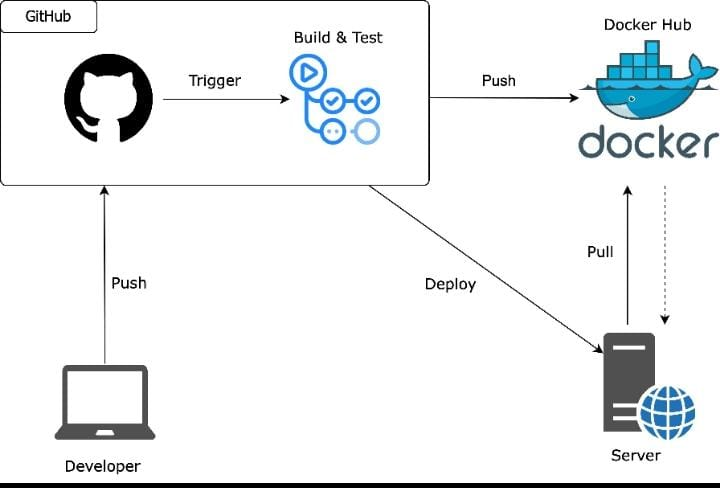
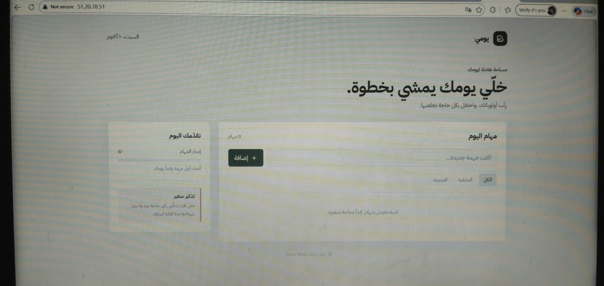

# Yomy Task App

[](https://github.com/moashraf675/automated-ci-cd-pipline-for-deckerized-web-app/actions/workflows/ci.yml)
[](https://nodejs.org/)
[](https://www.docker.com/)

A small Arabic-language task manager built with Node.js, Express, and Docker. This repository demonstrates automated testing, Docker image publishing, and deployment to an EC2 server with GitHub Actions.

## Contents

- [Features](#features)
- [Architecture](#architecture)
- [Requirements](#requirements)
- [Run locally](#run-locally)
- [Run with Docker](#run-with-docker)
- [CI/CD pipeline](#cicd-pipeline)
- [Configure deployment](#configure-deployment)
- [Security](#security)
- [Troubleshooting](#troubleshooting)
- [Screenshots and workflow status](#screenshots-and-workflow-status)

## Features

- Add, complete, filter, and delete tasks.
- Persist tasks in browser `localStorage`.
- Serve the app and health endpoint with Express.
- Report build version and commit through `GET /version` when build variables are configured.
- Test application routes and deployment behavior with `node:test`.

## Architecture



The developer pushes code to GitHub. GitHub Actions tests the application and builds a Docker image. On pushes to `main`, the workflow publishes the image to Docker Hub and connects to EC2 over SSH to deploy it.

| Component | Location | Responsibility |
| --- | --- | --- |
| Web UI | `index.html` | Arabic task manager interface and browser-side behavior |
| Express app | `app.js`, `server.js` | Serves the app on port `3000`, plus `/health` and `/version` |
| Tests | `test/` | HTTP route and deployment tests |
| GitHub Actions | `.github/workflows/ci.yml` | Tests, builds, publishes, and deploys the app |
| Container | `Dockerfile` | Packages the Node.js application |

## Requirements

- Node.js 22 or newer and npm for local development.
- Docker for building and running the container.
- A GitHub repository with Actions enabled.
- For deployment: an EC2 Linux server with Docker, SSH access, and inbound TCP ports `22` and `80` configured as described below.
- A Docker Hub account and repository for the published image.

## Run locally

```bash
npm ci
npm start
```

Open <http://localhost:3000>.

Available endpoints:

```text
GET /health   -> { "status": "ok" }
GET /version  -> { "version": "...", "revision": "..." }
```

Run the test suite:

```bash
npm test
```

## Run with Docker

Build and run the app locally:

```bash
docker build -t task-board .
docker run --rm --name task-board -p 8080:3000 task-board
```

Open <http://localhost:8080>. Port mapping uses `HOST_PORT:CONTAINER_PORT`; the Express server listens on container port `3000`.

## CI/CD pipeline

The workflow is defined in `.github/workflows/ci.yml` and runs for pull requests targeting `main` and pushes to `main`.

### Pull requests

1. Check out the repository.
2. Set up Node.js 22 and npm caching.
3. Install the locked dependencies with `npm ci`.
4. Run `npm test`.
5. Build a Docker image as a validation step.

Pull requests do not publish images or use deployment secrets. If tests fail, the job fails and later steps are skipped.

### Pushes to `main`

After the same dependency installation and tests, the workflow:

1. Builds the image with Docker Buildx.
2. Logs in to Docker Hub using GitHub Actions secrets.
3. Publishes `<DOCKERHUB_USERNAME>/cipp` tagged with both the commit SHA and `latest`.
4. Loads the SSH key into a temporary agent and connects to EC2.
5. Pulls the commit-specific image, replaces the `cipp` container, and starts it with `--restart unless-stopped` on host port `80` mapped to container port `3000`.
6. Checks that the new container is running.

The workflow deploys the commit-SHA image so the server receives the exact image built for that push, rather than resolving `latest`.

## Configure deployment

### EC2 setup

1. Install and start Docker on the EC2 host.
2. Ensure the SSH user can run Docker commands without `sudo`.
3. Allow inbound TCP `80` from intended users and SSH TCP `22` from the GitHub Actions runner or another restricted, trusted source.
4. Create a Docker Hub repository named `cipp` under the account used by the workflow. It must be public if EC2 is expected to pull without Docker Hub credentials.

### GitHub Actions secrets

Add these under **Repository Settings → Secrets and variables → Actions**:

| Secret | Value |
| --- | --- |
| `DOCKERHUB_USERNAME` | Docker Hub username |
| `DOCKERHUB_TOKEN` | Docker Hub access token with the minimum required permissions to publish images |
| `EC2_HOST` | EC2 public IP address or public DNS name |
| `EC2_USER` | SSH login name only, such as `ec2-user`; do not include `@host` |
| `EC2_SSH_KEY` | Full PEM private key authorized for that EC2 user |

Once configured, a successful push to `main` triggers image publishing and deployment automatically. Pull requests run tests and a Docker build only.

### Deployment behavior and limitations

The current deployment step pulls the new image, removes the existing `cipp` container, starts the new one, waits two seconds, and checks that it is running. It does not currently perform an HTTP health check or roll back automatically if the new application fails after startup; the replacement can cause brief downtime. For production, add a health check and rollback or use a rolling deployment strategy.

## Security

- Store Docker Hub credentials and the EC2 private key only in GitHub Actions Secrets; never commit them or print them in logs.
- The local `cpr.pem` file is excluded by `.gitignore` and `.dockerignore`. Do not add it to Git or the Docker build context. If a real private key was ever exposed, revoke and replace it; deleting the file alone is not sufficient.
- `.dockerignore` excludes PEM/key files, environment files, `node_modules`, and GitHub metadata from the Docker build context.
- Use a least-privilege Docker Hub token, restrict SSH ingress, and grant the EC2 deployment account only the permissions it needs.
- The workflow currently obtains the SSH host key with `ssh-keyscan`. For stronger host authentication, pin and verify the EC2 host key instead of trusting a key collected during each run.
- The attached server screenshot uses HTTP. Use HTTPS with a domain, TLS certificate, and reverse proxy or load balancer before production use.

## Troubleshooting

| Error or symptom | Cause | Resolution |
| --- | --- | --- |
| `FROM node  lastest` or base image pull failure | The image reference is malformed; `latest` was misspelled and the tag separator is missing. | Use the valid, project-compatible base image `FROM node:22-alpine`. |
| `pull access denied for myapp` | Docker cannot find a local `myapp` image and tries to pull it from a registry. | Build it first with `docker build -t myapp .`, or run the image using its actual published name. |
| Container starts but the page is unreachable | The host port was mapped to container port `5000` or `4000`; Express listens on `3000`. | Use `-p 8080:3000` locally or `-p 80:3000` on EC2. |
| `Bind for 0.0.0.0:8080 failed: port is already allocated` | Another process or container is using host port `8080`. | Inspect `docker ps` and `lsof -nP -iTCP:8080 -sTCP:LISTEN`; stop only a container you own, or select another host port such as `8081:3000`. |
| SSH deployment times out or is denied | Incorrect host, username, key, or inbound SSH rule. | Check `EC2_HOST`, `EC2_USER`, `EC2_SSH_KEY`, the EC2 authorized key, and the security-group rule for port `22`. |
| Workflow stops before Docker build or deploy | `npm test` failed. | Open the **Run tests** step in the Actions run, fix the failing test, and rerun `npm test` locally. |

## Screenshots and workflow status

The badge below shows the live workflow status for `main`; select it to open GitHub Actions. A recent successful run is available [here](https://github.com/moashraf675/automated-ci-cd-pipline-for-deckerized-web-app/actions/runs/38037646143).

[](https://github.com/moashraf675/automated-ci-cd-pipline-for-deckerized-web-app/actions/workflows/ci.yml)

### Deployed application



### Architecture diagram


